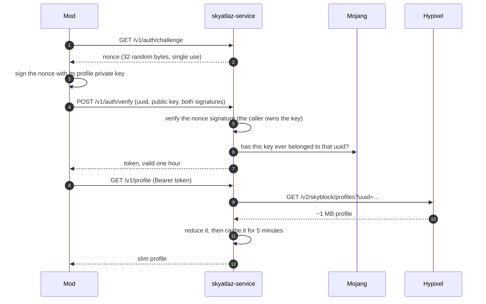

<div align="center">

# skyatlaz-service

**One Hypixel key, on a machine you control, serving the profile of the player who asks for it.**

A small, self-hosted Rust service that lets the [SkyAtlaz](https://github.com/bgrados31/skyatlaz)
Minecraft mod read the SkyBlock profile of the player using it, without every
player having to own a Hypixel developer key.

[](https://github.com/bgrados31/skyatlaz-service/actions/workflows/ci.yml)
[](https://github.com/bgrados31/skyatlaz-service/actions/workflows/audit.yml)
[](LICENSE)
[](rust-toolchain.toml)
[](#status)

[Why](#why-this-exists) ·
[Endpoints](#endpoints) ·
[Authentication](#how-the-authentication-works) ·
[Configuration](#configuration) ·
[Development](#development) ·
[Deployment](#deployment) ·
[Security](SECURITY.md)

</div>

## Why this exists

The Hypixel API policy is explicit about keys inside mods:

> API Keys are not intended to be used and shared with 3rd party mods or services,
> we will not grant applications for this purpose.
> — [Information for Developers](https://support.hypixel.net/hc/en-us/articles/4416373008788-Information-for-Developers)

A mod that ships one key to every player breaks that rule and turns a single key
into a shared secret that cannot be rotated. The alternative, used by
[Skyblocker](https://github.com/SkyblockerMod/Skyblocker) with `hysky.de`, is to
keep one key in a service and let players authenticate as themselves. This is that
service: small enough to read in an afternoon, boring on purpose, and yours to
deploy.

The service holds the key. The player's mod proves who it is with the Minecraft
profile key pair it already has, and then asks for **its own** profile. There is
no endpoint that reads the profile of somebody else, and no account system,
database or second process to keep alive.

## Features

- **The Hypixel key never leaves the process.** It is not logged, not serialized,
  not returned in an error and never put in a url.
- **Identity comes from a signature, not from the request.** The mod signs a
  single use nonce and proves its key belongs to its uuid through Mojang's
  signature over the public key.
- **A slim profile, not the whole answer.** The upstream profile is about 1 MB;
  the service keeps the mining tree, the dungeons and the currencies, so the
  cache and the game traffic stay small.
- **Bounded everything.** The profile cache and the nonce store have hard caps,
  the per-address challenge limit has a capped table of addresses, the body limit
  and the timeouts are fixed. Memory is a function of configuration, not traffic.
- **Honest errors.** `404 profile_not_found`, `503 rate_limited` with
  `Retry-After`, `429 too_many_requests`, `502 upstream_error` with the cause in
  the log and never in the body.
- **One retry, and only when it can help.** A `5xx`, a refused connection or a
  timeout is tried once more with jitter; a `4xx`, a used up rate limit or a
  player without a profile is not.
- **Readable counters.** `/metrics` in the Prometheus text format, with fixed
  label sets so a caller cannot make the table grow.
- **No OpenSSL, no database, no Redis.** One static-ish binary and a pinned
  toolchain.

## Quick start

You need a Hypixel developer key ([developer.hypixel.net](https://developer.hypixel.net))
and, for the container, Docker. Nothing else.

### Docker

```bash
git clone https://github.com/bgrados31/skyatlaz-service.git
cd skyatlaz-service

docker build -t skyatlaz-service .
docker run --rm -p 127.0.0.1:8080:8080 \
  -e HYPIXEL_API_KEY=your-key \
  -e SKYATLAZ_TOKEN_SECRET=$(openssl rand -hex 32) \
  skyatlaz-service
```

### From source

```bash
git clone https://github.com/bgrados31/skyatlaz-service.git
cd skyatlaz-service
cp .env.example .env     # then put your key in it
cargo run --release
```

```bash
curl http://127.0.0.1:8080/health
```

```json
{"ok":true,"service":"skyatlaz-service","version":"0.1.0",
 "rate_limit":{"limit":300,"remaining":299},"cache":{"entries":0}}
```

Point the mod at it with the `service.url` setting
(`http://127.0.0.1:8080` is the default) and it takes care of the rest.

> **Note on `SKYATLAZ_TOKEN_SECRET`:** leave it empty and the service generates a
> random one on every start, which is fine for a single run and useless after a
> restart, because every session token dies with the process. Set it to 32 bytes
> or more (`openssl rand -hex 32`) as soon as the service is more than a toy.

## Endpoints

| Method | Path                 | Auth             | Description                              |
| ------ | -------------------- | ---------------- | ---------------------------------------- |
| GET    | `/health`            | none             | Liveness probe with the upstream budget and the cache size. |
| GET    | `/metrics`           | none             | Counters in the Prometheus text format.  |
| GET    | `/openapi.json`      | none             | The contract of the service (OpenAPI 3.1). |
| GET    | `/v1/auth/challenge` | none             | Hands out a single use nonce.            |
| POST   | `/v1/auth/verify`    | signed nonce     | Verifies the signatures, returns a token. |
| GET    | `/v1/profile`        | `Bearer <token>` | The slim profile of the caller.          |

Everything under `/v1` answers with `Cache-Control: no-store`, and every error is
JSON with an `error` code and a `message`, including the ones the framework would
answer by itself.

### Status codes

| Status | `error`             | When                                                    |
| ------ | ------------------- | ------------------------------------------------------- |
| `401`  | `unauthorized`      | Missing, malformed or expired token; bad signature. Carries `WWW-Authenticate`. |
| `404`  | `profile_not_found` | The player has no SkyBlock profile the service can read. |
| `404`  | `not_found`         | No route matches the path.                              |
| `413`  | –                   | The request body is larger than 64 KiB.                 |
| `429`  | `too_many_requests` | More than 30 challenges from one address in a minute. Carries `Retry-After`. |
| `502`  | `upstream_error`    | Hypixel failed or could not be reached.                 |
| `503`  | `rate_limited`      | The key used up its window. Carries `Retry-After`.      |

## How the authentication works

The mod never sends a password, an email or a Hypixel key. It uses the key pair
Minecraft already gives every account.



Both signatures are checked before a token exists: the signature over the nonce
proves the caller holds the private key, and Mojang's signature over the public
key proves that key belongs to the uuid in the request. The token is an HMAC over
`uuid:expires_at`, so a restart with the same secret keeps sessions alive and a
leaked token cannot be edited without breaking the MAC. The uuid of a request
comes from the token and from nowhere else.

## Configuration

Everything comes from the environment; `.env` is read in development and ignored
by git.

| Variable                | Required | Default                   | Description                                          |
| ----------------------- | -------- | ------------------------- | ---------------------------------------------------- |
| `HYPIXEL_API_KEY`       | yes      | –                         | Your Hypixel developer key.                          |
| `SKYATLAZ_TOKEN_SECRET` | no       | random on every start     | Secret that signs the session tokens (32+ bytes).    |
| `BIND`                  | no       | `127.0.0.1:8080`          | Address the server listens on.                       |
| `PORT`                  | no       | –                         | Used when `BIND` is unset; listens on `0.0.0.0`.     |
| `HYPIXEL_API_BASE`      | no       | `https://api.hypixel.net` | Base url of the Hypixel API.                         |
| `PROFILE_TTL_SECONDS`   | no       | `300`                     | How long a profile stays cached.                     |
| `PROFILE_CACHE_ENTRIES` | no       | `1024`                    | How many profiles the cache may hold (max 100 000).  |
| `TOKEN_TTL_SECONDS`     | no       | `3600`                    | How long a session token stays valid.                |

A value the service cannot work with stops it at startup instead of failing
later: a zero ttl, a cache size out of range, a `PORT` that is not a port. The
message names the variable and the value it read.

## Limits and budgets

| Thing | Value | Why |
| --- | --- | --- |
| Upstream requests | 120 per 5 minutes (a personal key; some advertise 300) | The cache TTL is the throttle. |
| Profile TTL | 300 s → at most 12 upstream requests per player per hour | ~120 players served continuously by one key. |
| Cache | 1 024 entries by default, 100 000 hard cap | Tens of megabytes at the default. |
| Nonce store | 10 000 entries, single use, expired ones dropped | The endpoint is unauthenticated. |
| Challenge rate | 30 per address per minute, 10 000 addresses tracked | One address cannot flood it; the table is capped. |
| Request body | 64 KiB | A verify request is about 1 KiB. |
| Upstream timeout | 20 s | Bounds a stuck connection, including the retry. |
| Request timeout | 30 s | Bounds everything else, a slow client included. |

The service measures the cached path with `curl`; on the development machine
(Windows 11, release build, loopback, one cached 71.5 KB profile) `GET /health`
is p50 0.84 ms / p95 1.15 ms and a cached `GET /v1/profile` is p50 1.92 ms /
p95 5.42 ms, against 1.23 s for a cold one.

## Observability

- **Logs:** structured `tracing` output, one INFO span per request with method,
  path, status and latency. `RUST_LOG=debug` adds the reasons behind an upstream
  failure. Tokens, nonces, keys and signatures never reach the log.
- **`/health`:** version, the upstream rate limit state and the cache size.
- **`/metrics`:** request counts per route and status class, a latency histogram
  per route, cache hits and misses, profile fetches by outcome, the retries they
  needed, and gauges for the cache size and the remaining request budget. Every
  label value comes from a closed set, so a caller cannot widen the table.

The repository's `Caddyfile` answers a public `GET /metrics` with `404`: the
counters are for the machine that scrapes them, not for the internet.

## Development

The toolchain is pinned in `rust-toolchain.toml`, so `rustup` installs the same
compiler CI uses on first run.

```bash
cargo fmt --all
cargo clippy --all-targets --locked -- -D warnings
cargo test --all-targets --locked
cargo build --release --locked
```

CI runs exactly those on Linux and Windows (`.github/workflows/ci.yml`), plus a
weekly `cargo audit` (`.github/workflows/audit.yml`). The tests need no network
and no key: Hypixel answers are `serde_json::json!` fixtures, RSA keys are
generated in the test, and the one test that needs an upstream starts a fake one
on a loopback port.

- Rules for changing the code: [`AGENTS.md`](AGENTS.md).
- Design, budgets and failure modes: [`docs/ARCHITECTURE.md`](docs/ARCHITECTURE.md).
- What is done and what is next: [`docs/ROADMAP.md`](docs/ROADMAP.md).
- How to contribute: [`CONTRIBUTING.md`](CONTRIBUTING.md).

## Deployment

The service listens on loopback and expects a reverse proxy to own TLS and the
public address. [`deploy/README.md`](deploy/README.md) walks through an Oracle
Cloud Always Free instance: systemd unit, Caddy, environment file, firewall and
the checks to run before sharing the url.

```bash
scp target/release/skyatlaz-service server:/tmp/
```

A tagged release publishes `skyatlaz-service-{x86_64,aarch64}-unknown-linux-musl`
tarballs with a `SHA256SUMS` (`.github/workflows/release.yml`, exercised by
`v0.1.0`), so a deploy is a download instead of a five minute compile on a small
VM.

## The contract

The service publishes its own contract at `/openapi.json`, and the mod keeps a
copy of it, refreshed with:

```bash
./tools/service/sync.ps1                # from the mod repository
```

A field, a status code or a header changes in the code, in `openapi.json` and in
a test in the same commit, so the mod fails its build instead of failing in game.

## Security

The design keeps a secret that belongs to you, so the interesting parts are
written down: the invariants (`AGENTS.md`), the threat model and the failure
modes (`docs/ARCHITECTURE.md` §6 and §7), and how to report a problem
([`SECURITY.md`](SECURITY.md)).

Two things to do before the service is reachable from the internet: put it
behind TLS, and add a rate limit for `GET /v1/auth/challenge` at the edge, since
that endpoint is unauthenticated and writes to memory.

## Contributing

Issues and pull requests are welcome. [`CONTRIBUTING.md`](CONTRIBUTING.md) has
the setup, the style rules and the checklist a change has to pass;
[`CODE_OF_CONDUCT.md`](CODE_OF_CONDUCT.md) is the usual Contributor Covenant.

## Status

Working and used locally with the mod: authentication, cache, rate limit
handling, retry, metrics, the deployment runbook and the tagged release are
done, and `v0.1.0` is the first release with prebuilt binaries. Not yet in
production on a public url. What is left is in
[`docs/ROADMAP.md`](docs/ROADMAP.md), and the biggest items are single-flight on
cache misses and a fuzzed parser.

## License

[MIT](LICENSE) © the SkyAtlaz contributors. Not affiliated with Hypixel Inc. or
Mojang Studios.
